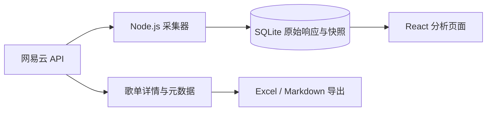

# 听迹 · NeteaseMusic Analyze

本地运行的个人网易云音乐听歌数据分析工具。继续使用网易云客户端听歌，在浏览器里查看自己的歌曲、歌手、专辑、收听记录与官方报告，也可以导出歌单。

## 启动

需要 **Node.js 24 或更高版本**。

```powershell
npm.cmd ci
npm.cmd run dev
```

打开 <http://127.0.0.1:5173>，点击「连接网易云」，使用手机号＋密码或网易邮箱＋密码登录，也可以切换为扫码登录，再点击「同步数据」。页面上的「查看演示」使用合成数据，不会写入个人数据库。Windows PowerShell 中使用 `npm.cmd`，可以避免 `npm.ps1` 被执行策略拦截；其他终端也可使用 `npm`。

密码仅用于本次登录，不写入数据库、文件或日志；上游接口需要的 MD5 摘要由本机后端生成。成功后只保存会话 Cookie。密码登录同样可能触发网易云安全验证，不保证消除扫码时的风险提示；界面会显示接口返回的错误，不会自动重复尝试登录。

生产方式运行：

```powershell
npm.cmd run build
npm.cmd start
```

随后打开 <http://127.0.0.1:3001>。服务默认只监听本机地址。

## 已实现

| 页面       | 功能                                                                                                         |
| ---------- | ------------------------------------------------------------------------------------------------------------ |
| 听歌总览   | 切换数据源与快照；样本歌曲、参与歌手、可用播放次数；歌手与专辑分布                                           |
| 歌曲与歌手 | 曲目／次数／排行分数三种权重；歌手与专辑明细；发行年份、歌曲长度分布；搜索、已喜欢筛选、排序、分页、歌曲详情 |
| 排行对比   | 对比同一来源的任意可用快照，查看名次变化；未上榜不视作零次播放                                               |
| 收听习惯   | 基于最近播放 playTime 的记录日历、小时与星期分布、每日变化、重复出现比例与记录明细                           |
| 周期报告   | 浏览周月年报告、累计与实时数据、年度足迹、曲风偏好；嵌套字段检索、原始 JSON、数值字段跨周期对比、报告导出    |
| 歌单导出   | 读取创建与收藏的全部歌单；按链接或 ID 读取；预览、Excel 与 Markdown 导出；大歌单分批补齐详情                 |
| 数据管理   | 定时采集、单独同步数据源、月／周／年历史回填、来源状态、任务日志、JSON 导出与 SQLite 备份                    |

## 数据接入

通过固定版本的 [`@neteasecloudmusicapienhanced/api`](https://github.com/NeteaseCloudMusicApiEnhanced/api-enhanced) 在后端直接调用，不另外启动或公开其 HTTP 服务。

主要读取：

- `/record/recent/song`、`/user/record`：最近播放、一周／累计排行。
- `/listen/data/today/song`、`/listen/data/song/play/rank`：今日与周月歌曲排行。
- `/listen/data/total`、`/listen/data/realtime/report`、`/listen/data/report`：累计、实时与周期报告。
- `/listen/data/year/report`、`/summary/annual`：年度足迹与按年份读取的年度总结。
- `/style/preference`、`/recent/listen/list`、`/likelist`：偏好、补充列表与喜欢的歌曲。
- `/song/detail`：按歌曲 ID 补齐元数据，结果在本地缓存。
- `/user/playlist`、`/playlist/detail`：歌单及其完整条目；详情不足时分批请求歌曲元数据。

接口可用范围取决于登录状态、账号权益和网易云服务。报告字段尚未通过真实账号核验单位时，以原值和字段路径展示，不猜测时长单位。未识别的响应仍可在报告页或 JSON 导出中查看。

## 统计口径

- 每个数据源独立保存快照，不把不同来源、同一周期的累计数叠加。
- `playCount` 与 `score` 分开保存；缺失值显示「—」，有效的零保留为零。
- 合作歌曲按参与歌手平均分配统计权重，避免总占比超过 100%。
- 歌曲长度仅用于元数据分析，不推算实际收听时长、跳过率或听完率。
- 最近播放记录按「账号 + 歌曲 ID + playTime」去重。该接口可能只保留每首歌的最近一次播放，不能保证恢复完整流水。
- 日期与时段按 `Asia/Shanghai` 解释。没有观察记录的日期不等于没有听歌。
- 近 48 小时的快照全部列出；更早的数据按来源与周期归并显示最近一次成功／失败响应。所有原始归档仍保留在数据库和完整 JSON 导出中。

## 歌单导出与时间

Excel 文件包含冻结表头、筛选、歌曲链接、可排序的条目时间、来源说明，并按原歌单顺序导出。Markdown 包含同样的明细。

导出字段：序号、歌曲、歌手、专辑、歌曲时长、歌曲 ID、歌曲链接、歌单条目时间、时间字段来源、添加者 ID。

- 收藏歌单时间仅使用 API 明确返回的 `subscribeTime` / `subscribedTime`。很多歌单可能没有该字段。
- 歌曲条目时间优先保存 `trackIds.addTime`，其次保存 `trackIds.at`，同时注明字段来源。`at` 的实际含义需要通过真实账号数据核验，因此不直接标注为收藏时间。
- 不用歌单创建时间或更新时间替代收藏时间；未提供的时间留空。
- 缺失歌曲详情仍导出歌曲 ID 与原始顺序；如果条目数量小于歌单声明数量，文件中会同时列出两者。

## 采集与数据文件

默认每 30 分钟检查一次：最近播放按此间隔采集，其余常规数据源每天采集一次。手动「同步数据」会读取全部常规数据源。可关闭定时任务或调整间隔；电脑关机、休眠、后端停止时无法持续采集。

数据存储在忽略提交的 `data/` 目录：

- `music.sqlite`：歌曲、元数据缓存、原始响应、快照、去重记录、设置和任务日志。
- `session.json`：本机登录 Cookie，与数据库分开保存，不加密，不进入页面返回值或导出文件。
- `backup.sqlite`：通过页面生成的数据库备份，不含 Cookie；包含本机已采集的所有账号数据。

更换存储目录或生产端口，可以在 PowerShell 中设置后启动：

```powershell
$env:DATA_DIR = 'E:\MusicAnalyzeData'
$env:PORT = '3001'
npm.cmd start
```

开发服务器默认代理后端的 3001 端口；修改开发端口时需同步调整 `vite.config.ts`。

恢复备份：先停止服务，保留旧数据库及其 `-wal` / `-shm` 文件到其他目录，再将备份复制为 `data/music.sqlite`，然后启动。账号凭证仍需由本机保存或重新登录。

## 开发结构与验证



`server/` 为 Express、采集、SQLite 和文件导出；`src/` 为 React 与 ECharts 页面；`shared/` 包含类型和统计函数。

```powershell
npm.cmd run check
npm.cmd run build
```

只保留关键路径检查：字段解析、计数与分数分离、合作权重、快照对比、记录去重与账号隔离、历史周期、歌单补全与 Excel／Markdown 导出。没有引入全量测试框架。

目前已验证真实 API 二维码生成入口，并用公开歌单验证了 139 首歌曲的完整读取、Excel 导出回读与 Markdown 时间字段。个人报告权限、字段单位和收藏时间需要登录后通过真实响应进一步核验。演示数据只用于交互与布局检查，不代表 API 的实际报告结构。

依赖审计仍报告上游 API 的 PAC 代理链与 ExcelJS 的间接依赖告警；当前功能不启用 PAC 代理、不导入不可信 Excel 文件。未对这些上游依赖强制跨大版本替换。
